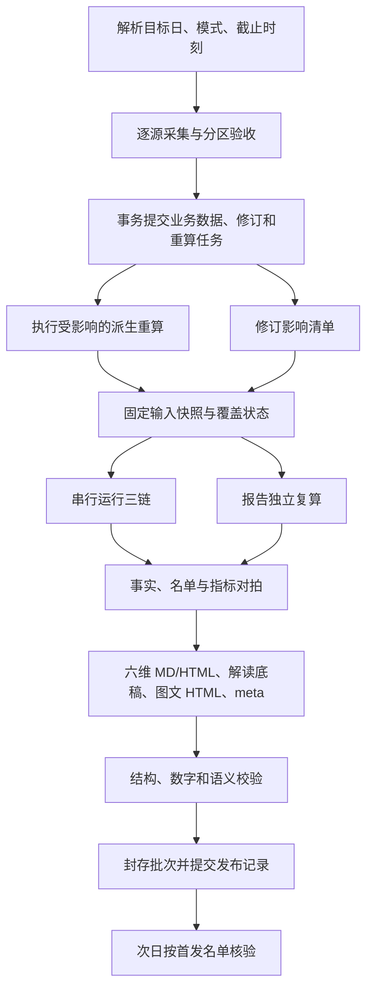

# 每日复盘采集与分析闭环技术方案

**版本** V1.0　｜　**日期** 2026-11-19　｜　**状态** 设计稿，待实施

本方案将[优化方案 V1.0](每日复盘采集与分析闭环优化方案-V1.0-20261119.md)展开为代码、数据契约、存储、计算、发布和验收设计。问题证据见[两轮评审记录](复盘逻辑优化建议-20261118.md)。设计基于当前本机代码，文中标为“新增”“拟新增”的文件、接口、表和命令均尚未实现。

本次范围是修复数据到数、分析口径和发布核验闭环。沿用已有数据源、Python 分析链、PostgreSQL、文件报告及 stock-analysis-chain skill。保留[11 月 18 日采集修复](../../数据采集链路风险修复技术方案-20261118.md)已有的完整性保护、熔断、复权兜底台账和限流机制。告警仍进入作业汇总，不恢复已按用户要求移除的外部推送。

## 1. 技术目标与现有改动边界

系统以三个可追溯对象贯穿全链路。

| 对象 | 身份 | 解决的问题 |
|---|---|---|
| 采集作业与分区 | `job_id`、`partition_id` | 哪个市场、哪一天、哪些代码或页没有到齐 |
| 固定输入与数据修订 | `snapshot_id`、`revision_id` | 计算用了哪些数据，补采后哪些结果需要重算 |
| 已发布批次 | `batch_id` | 当时发布了什么名单、基准和结论，后续修订改了什么 |

必须保持以下约束。

1. 目标业务日、源实际日、报价时刻、首次观察时刻和报告截止时刻分别保存。历史补采不能倒签成当时已经可知。
2. 缺源、零记录、零命中和零收益是不同状态。只有经验证的数值才进入有效样本分母。
3. 同一批三链和报告使用同一输入快照。报告保留独立组装、复算能力，不改为从 CSV 抄取计算结果。
4. 正式核验使用已发布首发名单。修订数据、修订报告和影子池另有身份，不覆盖首发。
5. 完整批次通过校验后才可消费。失败的采集分区可以续跑，失败的报告半批不能成为预测依据。

### 1.1 现状与接入点

| 现有实现 | 已确认的接入点 | 本方案改动 |
|---|---|---|
| 采集编排 | `ReviewSyncOrchestrator.execute/_run_waves/_build_runners/_fill_entry` | 输入统一上下文，分区验收，拆分数据依赖与限流互斥，返回明确作业状态 |
| 日 K 同步 | `SyncManager.sync_kline_day`、`kline_day_pipeline.process_one_stock` | 运行模式与目标日解耦，保留原始异常，输出逐代码修订 |
| 读取器 | `DataReader(config_manager, conn=None)` | 增连接所有权，支持共享事务，逐步抽取类型化读取接口 |
| 分析链 | `ChainEngine.run` 内部创建和关闭读取器 | 注入读取器工厂或快照参数，输出输入指纹 |
| 聚合 | `ReviewAggregator.aggregate`、`AGG_CACHE_VERSION` | 输入版本进入缓存键，状态和来源日期随指标输出 |
| 报告与图文 | `ReviewReportGenerator.generate`、`digest.build_digest` | 拆构建和发布，消除图文生成期间的实时补查 |
| 候选 | `tomorrow_plan._buy_candidates` 执行过滤，`verifier.build_predictions` 保存原始池 | 抽出共享发布名单函数，冻结实际展示范围 |
| 预测 DAO | `upsert_review_prediction/upsert_review_verification` 按日期覆盖 | 新表保留批次版本，旧表只作 legacy 数据源 |

现有 DAO 的通用写方法会自行提交事务，不能直接串接它们来保证“数据写入＋修订记账”原子性。当前 digest 除聚合对象外，还通过 `_sparkline_series` 查询数据库，仅冻结 `agg` 不足以冻结五份产物。这两处属于必须改造的边界。

## 2. 总体流程



采集和报告构建可以分别重试。`sync-review-all` 仍负责采集，新增发布流程承接三链、报告和 skill 产物。一个报告批次可消费多个采集作业的有效分区，不能把“最后一次作业成功”直接当作全部输入完整。

## 3. 公共数据契约

### 3.1 日期、运行模式与可知时点

拟新增 `backend/src/sync/collection_contracts.py`，采用 dataclass 和枚举。契约示意如下，省略非关键实现代码。

```python
RunContext(
    job_id, parent_job_id,
    target_date,             # A 股报告锚定日，边界统一为 YYYYMMDD
    run_mode,                # DAILY / BACKFILL / INIT
    cutoff_at,               # 带时区时间，入库使用 TIMESTAMPTZ
    calendar_version,
    dry_run,
)

PartitionResult(
    dataset, source, market, partition_key,
    expected_date, source_business_date,
    quote_at, source_published_at, first_observed_at,
    availability_basis,
    status, reason_codes,
    expected_codes, observed_codes, invalid_codes, missing_codes,
    page_evidence, quality, recoverability,
    revision_id,
)
```

`DAILY` 缺省目标日取 `latest_closed_trade_date`。跨零点补跑仍取最近已收盘交易日。显式指定目标日不再通过 `bool(start_date and end_date)` 推断同步模式。区间补采使用 `BACKFILL`，每个交易日产生独立分区结果。

新数据保存源报价时刻和系统首次观察时刻。严格“当时已知”回放要求输入在决策截止前已被系统记录，且源时刻不晚于截止。只有官方历史发布时间证据、但系统后来才取得的数据，可用于标明“公开可得重建”的研究视图。两类结果不能混入正式历史战绩。历史 `create_time`、本次修复时间和文件修改时间都不自动视为真实首次可用时间。

市场日历、收盘时段、发布延迟和源代码注册表由拟新增 `sync/source_expectations.py` 统一提供，输出 `expected_partition(context)`。涉及美国时区时按当地时区和夏令时转换。尚未发布的源返回 `NOT_DUE`，日历未知返回待核，不能用自然日差硬算过期。宏观数据按指标发布频率判断，两融按其业务日与发布延迟判断。

### 3.2 分区状态与指标状态分开

| 分区状态 | 含义 | 续跑与下游行为 |
|---|---|---|
| `COMPLETE` | 所需页、代码和字段验收完成 | 相同版本可复用 |
| `CONFIRMED_EMPTY` | 源已发布且有证据证明该分区为空 | 可判断无记录，不能当请求失败 |
| `NOT_DUE` | 截止时刻尚未应发布 | 不列为采集失败，指标显示尚未到时 |
| `PARTIAL` | 部分代码、分页或字段有效 | 使用明确有效子集，缺失部分可续跑 |
| `FAILED` | 请求、解析或校验失败 | 保存错误类别和可重试性 |
| `BLOCKED` | 上游不可用或源风控 | 保留依赖原因，独立源继续 |
| `UNRECOVERABLE` | 历史快照无法恢复 | 永久保留证据缺口 |
| `NOT_APPLICABLE` | 该数据集不适用 | 不进入应到分母 |
| `PLANNED` | dry-run 的计划结果 | 无数据库写入和源请求 |

指标另用 `VALID / PARTIAL / UNAVAILABLE / NOT_APPLICABLE`，携带机器可读原因，例如 `SOURCE_STALE`、`DATE_UNVERIFIED`、`NO_PAIRED_SAMPLE`、`COHORT_UNKNOWN`。有旧值的指标可同时保存旧值和来源日，但当日状态仍为不可用。布尔命中采用 `TRUE/FALSE/UNKNOWN`，避免把缺龙虎榜映射成 `FALSE`。

完整性依据来自本批冻结的股票池、源声明页数及记录总数、必需代码注册表和有效字段。历史行数阈值只作异常检测，不能证明 ETF、龙虎榜等源当天一定完整。

### 3.3 统一事实结构

拟新增 `backend/src/review/contracts.py`，所有聚合结果逐步输出 `MetricFact`。

```json
{
  "metric_id": "capital.etf.share_change",
  "schema_version": 1,
  "value": null,
  "unit": "share",
  "status": "UNAVAILABLE",
  "reason_codes": ["NO_PAIRED_SAMPLE"],
  "anchor_date": "20261117",
  "period_start": "20261116",
  "period_end": "20261117",
  "formula_id": "etf_paired_delta_v1",
  "cohort_id": "wide_etf_7_v1",
  "sample": {"expected": 7, "paired": 0},
  "source_refs": [],
  "snapshot_id": "<固定输入摘要>"
}
```

实际实现同时支持 `expected_date`、`actual_date`、`cutoff_at`、时区、分子分母、价格口径和四个跨市场日期端点。百分比以 `pct`、百分点差以 `pp` 区分，金额和份额保存基础单位，渲染时再换算。计算使用未舍入数值，展示精度不能回流到计算。

## 4. 存储与事务设计

### 4.1 新增六张闭环控制表

使用 PostgreSQL，日期沿用项目 `VARCHAR(8)` 边界格式，新时间字段使用 `TIMESTAMPTZ`。ID 由应用生成 UUID，不依赖新增数据库扩展。以下是字段和约束设计，实施时同步编写建表、升级及回退 SQL。

| 新表 | 核心字段 | 约束与索引 |
|---|---|---|
| `sync_job` | `job_id UUID`、`parent_job_id`、`target_date`、`run_mode`、`cutoff_at`、`calendar_version`、`config_hash`、`requested_sources JSONB`、`status`、`started_at/finished_at` | 主键 `job_id`，索引 `(target_date, started_at)` |
| `sync_partition` | `partition_id UUID`、`job_id`、`dataset/source/market/partition_key`、`expected_date/source_business_date`、时间证据、`status`、覆盖与分页 JSONB、错误 JSONB、`revision_id` | 主键 `partition_id`，唯一 `(job_id,dataset,source,market,partition_key)`，索引 `(dataset,market,expected_date,status)` |
| `dataset_revision` | `revision_id UUID`、`dataset/partition_key`、`parent_revision_id`、`job_id`、`content_hash`、`quality_hash`、`schema_version`、`snapshot_uri`、`changed_keys/fields JSONB`、`created_at` | 主键 `revision_id`，索引 `(dataset,partition_key,created_at)`。同一分区提交加锁，父版本不得分叉 |
| `recompute_task` | `task_id UUID`、`module/module_version`、`anchor_start/end`、`codes JSONB`、`scope_hash`、`trigger_revisions JSONB`、`required_input_hash`、`status`、`attempts`、`attempt_token/lease_owner/lease_until`、结果指纹、错误 | 唯一 `(module,module_version,anchor_start,anchor_end,scope_hash,required_input_hash)`，索引 `(status,lease_until)` |
| `review_batch` | `batch_id UUID`、`anchor_date`、`kind`、`first_batch_id/revision_of`、`status`、`is_original_first/is_current`、`cutoff_at`、`input_manifest JSONB`、代码/规则/配置/skill 摘要、`facts/candidates/predictions JSONB`、`artifact_manifest JSONB`、`batch_key`、`published_at` | 非空 `batch_key` 唯一。每锚日一个已发布原始首发、一个 current 的部分唯一索引。发布后的载荷不可改 |
| `review_verification_version` | `verification_id UUID`、`prediction_batch_id`、`evaluation_date`、`scope`、`metric_id`、`horizon`、`result_snapshot_id`、`metric_version`、`payload JSONB`、`created_at` | 唯一 `(prediction_batch_id,evaluation_date,scope,metric_id,horizon,result_snapshot_id,metric_version)` |

`kind=FIRST/REVISION/LEGACY/RESEARCH`。只有 `PUBLISHED` 批次能设为 current。原始首发的唯一索引条件为 `status='PUBLISHED' AND is_original_first=true`，包括有证据恢复的 LEGACY 首发，不只检查 kind=FIRST。首发的 `first_batch_id` 指向自身，其修订指向该首发。不可变要求针对事实、名单、预测、输入及产物载荷，current 指针等发布管理字段可按事务调整。首发身份不因回滚改变。历史研究批次不得抢占真实首发身份。

`partition_key` 使用统一规范，至少包含业务日期、市场、交易所及子数据集，逐标的行情再包含代码。数据集的源选择策略决定 source 是否属于身份，备用源替换同一数据分区时沿用其修订链。分区结果、修订记录和锁必须调用同一个键构造器，不能各自拼接。范围任务拆成明确业务日期分区后记账。

候选成员保存在批次 JSONB 中，同时归档到 `candidate_publication.json`。当前单日报告规模无需再建独立成员表。旧 `review_prediction_daily` 和 `review_verification_daily` 保留为 legacy，不通过修改其中的 `version` 数字冒充历史版本管理。

新增 DAO 建议拆为 `database/dao_collection_lineage.py` 和 `database/dao_review_publication.py`，注册到 `DatabaseConnection`。沿用项目 `ensure_*` 与 SQL 留档方式，不在本次引入迁移框架。新增 `doc/migrations/20261119_review_closed_loop_up.sql` 和对应回退脚本，并同步[初始化 SQL](init-V3.sql)。启动自动 ensure 只做兼容性建表，历史脏数据修订走独立迁移作业。

### 4.2 业务表增量字段

| 对象 | 变化 |
|---|---|
| `money_flow_daily` | 增 `collection_run_id/input_revision_id/rule_version/quality_state/quality_reason`，区分净额可算与占比缺分母 |
| `limit_seal_stats_daily` | 增上述质量字段及 `side`，有效业务唯一键改为 `(trade_date,ts_code,side)`，支持上涨、下跌分别记账 |
| `etf_scale_daily` | 增源业务日证据、采集时刻、日期质量和修订关联。正式唯一身份仍按业务日、交易所、基金代码 |
| `sentiment_metrics_daily` | 增 `input_snapshot_hash/formula_version/cohort_hash` 与分母信息，版本失配时不得复用 |
| 境内指数、外围日 K、两融、龙虎榜等 | 先由分区修订表提供来源关联，按业务唯一键定位，不为每张表重复添加完整控制字段 |

封板旧行无法确定方向时先标失效/待核，不默认全部迁为上涨封板。迁移期间先建立新方向记录和消费过滤，完成差异校验后再调整旧唯一约束。R1 只消费上涨方向且满足质量要求的字段，缺失开板次数保持空值。

另增业务表 `market_quote_snapshot`，保存不可变多时点报价，字段为 `quote_id`、`market_code/source`、`source_trade_date`、`quote_at`、`source_published_at`、`first_observed_at`、`availability_basis`、价格和汇率值、`payload_hash`、`quality_state`、`job_id`。同源同代码同报价时刻同载荷去重，源对同一时刻的修正保留新版本。旧 `overseas_market_daily` 可继续作为最新视图，不能再承担盘前历史证据。

### 4.3 分区写入事务

新增 `apply_partition(conn, partition, rows, revision, tasks)`，禁止在内部调用会自行提交的旧 DAO 方法。

1. 解析和校验源响应，生成规范化临时快照，先完成文件落盘和内容校验。
2. 开事务，取得 `(dataset, partition_key)` 的事务级锁，读取当前父版本。若锁前基础版本已变，重新合并源响应与当前分区、计算差异并生成快照，确保文件对应实际提交后的完整分区，不能直接覆盖为旧临时文件。
3. 比较业务值与质量状态。二者均不变只记录本次验收，不新增有效修订、不重复排重算任务。
4. 同一事务写业务行、分区验收结果、修订记录和 `recompute_task`。业务写入失败时全部回滚。
5. 提交后执行重算。进程此时退出，任务仍留在表中，后续按租约恢复。

快照文件先于数据库引用落盘。事务失败留下的无引用文件可以回收，数据库不得指向尚未完成的文件。数据内容不变但缺页得到确认、质量从待核变完整时，`quality_hash` 变化，仍需让下游重新判断。只有全分区完整替换时才允许清理缺席旧行，部分响应不得删除未返回的数据。

## 5. 采集层实施设计

### 5.1 分笔资金和封板

改造[MoneyFlowManager](../backend/src/sync/money_flow_manager.py)的 `execute/select_abnormal_stocks/_process_stock/_seal_row_for/compute_seal_stats`。

日常筛选和指定代码补采都先获得代码集，再调用拟新增 `load_stock_context(trade_date,codes)`，统一装载目标日昨收、高低收、成交额、板块、ST 及上市制度信息。沿用现有判定规则并版本化，不在修复补采入口时同步调阈值。

处理顺序为“上下文有效性 → 触板状态 → 分笔完整性 → 封板统计”。触板状态取 `UP/DOWN/BOTH/NOT_TOUCHED/UNKNOWN`。分笔净额可独立有效时保留，`amount` 不足时金额占比为 null。只有确认触及的方向才调用封板统计，不能把任意分笔最高价当涨停价，也不能用 `close<=low` 代替触及跌停方向的判断。

分笔为原始价，日 K 可能为复权价。对拍绝对价格前必须取得同口径原始价格或可靠换算证据，缺少时将封板质量降级。日 K 触板但分笔缺页、截断或窗口不完整，不可把首封时间、开板次数标为已确认。

续跑按输入版本、规则版本和质量状态判断，不再仅以“该日该股已有行”跳过。历史 657 行疑似错误封板先产出逐股差异，包含方向、旧统计、行情依据、失效原因和修订后值。11 月 17 日 699 行金额缺失用同股同日有效行情补齐并记录来源。

### 5.2 ETF 日期与分页

改造[EtfScaleManager](../backend/src/sync/etf_scale_manager.py)的 `parse_sse_rows/parse_szse_rows/fetch_sse/fetch_szse/execute`。

解析器返回 `EtfSnapshot(rows,business_date,date_evidence,pagination,source_hash)`。请求日期仅为查询条件，不能直接赋给响应业务日。深市最新接口无法确认历史日期时进入隔离目录，分区标 `DATE_UNVERIFIED` 或 `UNRECOVERABLE`，不得抓最新值填历史洞。

沪市实现响应分页遍历，深市记录源声明总数、总页数、实际页数、页哈希、去重基金数。重复页、中间空页、上限截断、跨页日期变化均不得判完整。全源完整性在过滤基金之前检查，报告七只宽基的覆盖另算。全量名单不能用历史 924/772 条硬编码替代源证据。

补采清单由“应有交易日分区 − 已验收分区”产生，覆盖最大日期之前的旧缺口。`execute` 增加真实 `dry_run` 参数，编排适配器透传，构造阶段也不能执行建表写操作。

报告计算固定篮子两日交集 `P=B∩Valid(T)∩Valid(T−1)`，随后计算 `Σ[shares_i(T)−shares_i(T−1)]`。交集为空时值为 null。部分配对展示基金代码和 `n/7`，名称使用“已配对基金份额变化”，不能扩大为全篮子净申赎。单位换算在渲染层执行。

### 5.3 龙虎榜与两融分区补采

改造[LhbManager](../backend/src/sync/lhb_manager.py)和[MarginManager](../backend/src/sync/margin_manager.py)的 `execute/backfill_range`，替换仅凭全日 `row_count>0` 跳过的策略。

龙虎榜分区为 `(日期,交易所,stock|seat)`，两融为 `(日期,交易所)`。每侧独立抓取、验收和提交，一侧异常不撤销另一侧成功。R4 读取股票榜和席位完整性，榜单有数据但席位缺页时返回不可判定。

确已发布空榜需要源发布及空结果证据。返回空数组、未到发布时间、接口失败分别处理。历史精确补采不得静默向前查几天并把较早结果计为完成。日常允许展示较早有效日，但保留目标日缺口和实际日期。

### 5.4 日 K、复权恢复与错误保存

`sync_kline_day` 显式接收 `run_mode` 与 `target_date`。独立日常入口和一键入口都走 DAILY 行为，包括接缝检查与因子触发清单。历史区间继续沿用 BACKFILL 的保护策略，不能通过是否传入日期意外切换。

在任何网络调用前初始化 `local_source_missing` 等局部状态，修复原始 `TdxApiUnavailableError` 被 `UnboundLocalError` 掩盖的问题。错误链保留连接/业务类别，现有共享熔断计数继续使用。

复用 `kline_day_raw_fallback` 台账，分别报告本次失败数、目标日已有行数、最终常规来源数和待恢复数。价格能力标记至少区分 `RAW_ONLY/QFQ_VALID/PRICE_INVALID`。使用涨跌幅、成交额或复权窗口的模块各自声明要求，不能将原始价兜底统一当正确或统一当错误。

补入缺日、金额修订、原始价转正、复权历史重述均记录变化字段和日期范围。复权变化可能覆盖更早历史，重算范围以真实变更集为准。

### 5.5 指数、外围和新鲜度

境内 TDX 的 7 个配置指数和中证接口的 2 个配置指数逐代码验收。中证指数行情与估值分别登记数据集，不共用一个最大日期代表两者到齐。固定尾窗之外的缺口进入定向回补任务。

外围股票、港指、美股指数和 A50 各按市场日历与截止时刻验收。`OverseasKlineManager` 取到空行不再增加已完成代码数。一条 A50 更新不能把其余 39 个代码变成新鲜。

`SinaSource.fetch_markets` 的 FX/HF 分支已有部分 `quote_date` 信息，但指数族的日期时间解析与传递仍需补齐，`OverseasManager.execute` 也须保留这些字段。无法确定源时间的报价标 `TIME_UNVERIFIED`，不用于严格盘前回放。

`FreshnessCheckManager.execute` 接收显式目标日和截止，读取分区结果及代码注册表。整表 `MAX(date)` 留作汇总，不再决定源状态。日历覆盖检查继续保留，未知市场假期不能直接假定正常交易。

## 6. 编排、固定输入与依赖重算

### 6.1 编排图与退出码

将 `SOURCE_DEPENDENCIES` 拆成两类声明。

| 声明 | 例子 | 调度行为 |
|---|---|---|
| 数据依赖 | 当日行情 → 估值、情绪、需要行情的资金计算 | 上游满足该模块字段/覆盖要求后才能执行，否则标 BLOCKED 或明确子集降级 |
| 资源互斥 | ETF 与两融访问同一交易所需串行 | 等前一任务释放资源即可，不要求前一任务业务成功 |

中间件健康失败仅阻断声明依赖中间件的节点。调度启动前检查循环依赖，删除死锁时强行提交任务绕过依赖的做法。警告、错误和新鲜度原因保存为列表，不能被最后一段 detail 覆盖。

顶层结果包含 `execution_status` 和 `data_readiness`。建议 CLI 退出码为完整执行 0、失败 1、参数错误 2、部分完成 3。`NOT_DUE` 不算执行失败，但报告对应指标仍不能使用尚未发布的数据。汇总文本和 JSON 使用同一结果对象。

dry-run 只读取本地配置和已有状态，生成计划，不向外部源请求，不调用 DDL、upsert、游标更新或发布写入。可以输出本地计划文件。所有 runner 和 manager 初始化路径均受此契约约束，特别是 ETF 与 HKEX。

### 6.2 输入快照与读取器改造

拟新增 `review/input_snapshot.py`、`analysis/read_repository.py` 和 `analysis/snapshot_reader.py`。快照包含日 K、指数和外围序列、股票池、交易日历、行业概念成员、资金封板、财报公告、汇率、分区质量和被核验首发批次。窗口取本批所有模块需求的并集，不把现有 60 日报告窗口当成全部输入。

数据库读取实现使用只读 `REPEATABLE READ`。`DataReader` 增 `owns_connection`，外部注入连接时由调用者关闭。`ChainEngine.run` 接收读取器工厂，三链串行执行。聚合及环境装配中的辅助查询必须共享同一事务快照，不能另从连接池获取新视图。事务视图一致不代表派生结果已更新，封存前必须核对情绪、估值等所有派生分区的输入指纹是否匹配捕获的基础版本，不匹配则在固定输入上重算或标不可用。

当前大量代码直接调用 `_query(SQL)`，压缩文件读取器不能自动执行这些 SQL。实施分为两步。

1. 先统一连接、事务和依赖声明，在相同事务视图中装载三链与报告所需数据，导出输入切片。digest 的 sparkline 等额外查询也并入依赖清单。长计算前完成导出并关闭数据库只读事务。
2. 将这些查询下沉为类型化接口，例如 `load_kline/load_index_series/load_overseas_series/load_etf_shares/load_membership/load_quality_context/load_financial_asof/load_previous_prediction`。数据库与快照实现返回相同结构。发布路径只消费已装载结构或快照读取器。

每迁移一个读取接口做数据库实现与固定快照实现的返回值对拍。离线模式遇未迁移查询直接失败，禁止偷偷回源。全部报告依赖覆盖前，只能声称“同事务一致生成”，不能声称“完整离线重放”。

规范化快照按数据集与业务日期分区，按主键排序、日期格式统一、Decimal 固定精度、缺失值统一为 null。内容摘要不含采集耗时或文件压缩时间戳。可用 gzip JSONL/CSV，初次仅导出所需历史窗口，之后复用未变化分区，不每日复制整个数据库。完整发布批次引用的快照和首发证据不按普通缓存清理。

`snapshot_id=SHA256(有序分区摘要＋质量摘要＋日历/股票池/成员版本＋schema)`。快照既保存文件位置，也保存其哈希、行数和字段规范。历史当前库导出的快照标为修订视图，不能据此证明当时数据库内容。

### 6.3 影响范围与重算

拟新增 `analysis/dependency_registry.py` 与 `sync/recompute_manager.py`。模块声明读取的数据集、字段、回看窗口、价格要求和影响传播规则。

| 变化 | 首要重算对象 | 范围规则 |
|---|---|---|
| 当日金额修订 | 资金占比、资金排序、候选、行业资金和报告 | 当日及明确使用该日的滚动资金窗口 |
| 缺日补齐、OHLC 或复权修订 | 封板、情绪、涨停样本、指标、缠论、估值 | 所有输入窗口相交的锚日。EMA/ADX/缠论等递推或状态计算从足够初始化点重放 |
| ETF、两融、龙虎榜补一侧 | 对应资金锚、R4、相关候选与报告 | 业务日与相邻配对日，不能只刷新补采日标题 |
| 指数/外围/汇率修订 | 双锚、ADX、P 情景、AH 和报告 | 截止及窗口涵盖修订记录的批次 |
| 行业概念成员、公告、规则或配置变更 | 依赖该集合或规则的分析 | 保留旧版，生成新规则/修订视图，不重写历史首发 |
| 覆盖状态由缺失变完整 | 原先 UNKNOWN 的指标和候选 | 即使已有数值不变也重新判定 |

任务状态为 `PENDING/RUNNING/SUCCEEDED/FAILED`，以租约处理进程中断，重试次数和错误类别保留。`scope_hash` 包含有序代码集及日期范围，完整日任务使用独立范围标识，不能把不同代码集的任务错误去重。输入指纹包含所依赖规则与模块版本。

每次领取任务生成新的 `attempt_token`，结果提交以条件更新核对 RUNNING 状态、租约持有者、token 和所需输入版本。过期 worker 或已失效输入的结果只能归档，不能覆盖当前派生结果。失败任务不能把旧派生值盖上新指纹继续使用。首次上线允许保守地重算受影响完整日期窗口，验证正确后再优化逐股范围。

聚合缓存键改为 `hash(as_of,snapshot_id,formula_version,config_hash,code_hash,schema_version)`。手工 `AGG_CACHE_VERSION` 只承担结构兼容版本。代码摘要包含影响计算的工作区文件，不能只取 Git HEAD。三链文件的 meta 必须带相同输入指纹，报告对拍不能读取固定目录中来源不明的“最新同日 CSV”。

## 7. 候选发布与昨日核验

### 7.1 共享候选决策函数

拟新增 `review/candidate_publication.py::build_candidate_publication(agg,rules,source_health)`，联合重构 `aggregator._build_candidates` 与 `tomorrow_plan._buy_candidates`。当前弱档否决、VETO 分流和跨池去重已在聚合器发生，渲染器主要追加情绪、ADX、排序及展示截取。不能只迁移渲染器，再把已经过滤的 `agg['candidates']` 命名为原始命中。

```text
CandidatePublication
  anchor_date / target_session / snapshot_id / rules_version
  pools[R1, R2, R3, R4, CHAN]
    status: OPEN | CLOSED | UNAVAILABLE
    reason_codes
    gate_policy_id       # 每类池独立的开放策略
    raw_members          # 弱档、否决和去重前的逐类规则命中
    shadow_members       # 指定基础规则阶段的影子研究范围
    eligible_members     # 闸门后全量
    published_members    # 排序、top_n 后实际发布
    digest_members       # 若另有精选，必须为 published 的子集
    excluded_members     # 代码、排除阶段和原因
```

每名成员保存完整 `ts_code`、排序、证据、质量状态和需要的事件身份。同分按 `ts_code` 稳定排序。迁移时先固定当前逐类判定、raw-R1 去重种子、VETO、弱档和报告闸门的执行轨迹，保存每阶段输入/输出及排除原因，再抽为带版本的决策流水线，不能为了抽函数悄然改变次序。影子统计指定 `shadow_stage_id`，链和报告只对同一阶段、同一截取范围的集合逐股比较。

CHAN 使用自身开放与关注策略，不自动套用 R1—R4 的右侧情绪/ADX 闸门。右侧池关闭不意味着清空缠论观察池，因此 17 日右侧正式池为 0 与 CHAN 的 18 只观察对象可同时成立。历史 R2=1、R3=7 的影子范围按原审查名单冻结，不能用新增的否决前 raw 集合替代并沿用旧收益数字。

R1 将 `pattern_match` 与 `seal_quality=CONFIRMED/PENDING/UNAVAILABLE` 分列。是否展示待核观察对象由既有候选策略明确决定，不能默认为封板质量通过。已发布的待核对象保留在实际发布名单，并在核验中按质量分层。R4 缺必需席位源时为 UNKNOWN，确已完整发布而无机构命中才为 FALSE。

`verifier.build_predictions` 改为接收该对象，不能自行从原始 `agg['candidates']` 重新抽名单。解读精选变化也需冻结，skill 不得将关闭池重新补成正式池。

### 7.2 样本与分母

拟新增 `review/cohorts.py`，保存 `cohort_id/anchor_date/member_codes/member_hash/definition_version/source_snapshot_id/evidence_kind`。证据类型区分 `ORIGINAL_PUBLISHED/RESTORED/RECOMPUTED_REVISION/UNRECOVERABLE`。

样本状态统计包括总体数、有行情数、有成交数、指标有效数、无成交数、缺行数和价格无效数。基础有效条件为目标日有行、`volume>0` 且所需价格/涨跌幅及口径有效。各指标可以加严，不能各自悄然改写基础分母。`money_effect` 与 `cross_section` 共用该判定。

前日样本通过交易日历连接明确 T 与 T+1，不使用同股“上一可得行”作为昨日。`_add_prev_limit_up` 改为按 T 的真实涨停代码集合关联 T+1。晋级按 T 的全部梯队遍历，成功为 0 的档位照常显示。

### 7.3 V1—V4 计算口径

| 核验项 | 冻结内容与公式 | 缺失处置 |
|---|---|---|
| V1 量能 | 保存首发成交额原值、展示值及阈值。量能变化以首发原值为基准 | 后来修订的 T 日成交额另列，不能替换首发基准 |
| V1.5 双锚 | 保存每锚基准日期、象限、量价读数和公式版本，对比 T+1 同口径值 | 实际日落后于应到日，迁移判定为待核 |
| V2 高度与晋级 | 保留原高度股验点，并冻结每档代码。成功为 T+1 有效且达到目标连续板数 | 展示成功、失败、停牌/无成交和缺数。总体分母不全时不声称完整晋级率 |
| V3 昨日涨停反馈 | 固定 T 日涨停集合，只用该集合在 T+1 的有效反馈算均值、中位数和翻红率 | 原成员不可恢复时不可精确核验。修订集合另有 cohort_id |
| V4 开盘跳空 | `gap_i=100×(open(T+1)/comparable_close(T)−1)`，超额为池中位跳空减同日市场中位跳空 | 两组使用相同价格/成交有效条件。仅描述开盘跳空 |
| V4 开盘入场持有 | h=1 为 T+1 开盘至当天收盘，h=20/60 为从入场交易日起第 20/60 个交易日收盘 | 不可成交、未到期、缺价分别列出，不自动顺延到更有利时点 |

持有净收益 `pct` 值定义为 `100×[exit_price×(1−sell_cost)/(entry_price×(1+buy_cost))−1]`，其中费用参数使用小数费率并包含声明的滑点。基准使用同一入场时点、持有区间及费用口径，两个 pct 值相减得到 pp。前后价格必须处于同一调整版本，除权日采用经验证的可比价格。价格跳空不等于开盘后可获得收益。

一字涨停、无成交等执行约束单独记录，没有成交证据时不宣称已成交。缠论事件用股票、类型、稳定结构标识和确认时点形成 `event_id`，同中枢重发保留关联，分别统计事件数与独立股票数。旧数据没有结构身份时标记无法去重。

正式池空池时 `count=0`、收益和胜率为 null。滚动统计分开正式池、影子池、精选子集、质量层和收益区间，记录开放日、空池日、不可核验日。相同预测批次的重复核验不能重复计入样本。结果版本选择显式保存为 `FIRST_RESULT` 或 `LATEST_RESTATED`，前者保留首次核验，后者使用最新有效修订实绩并标明修订，整段统计不能混用政策。两种政策都绑定同一首发名单。市场反馈统计与可执行交易收益分开呈现。

### 7.4 P1/P2/P3 与 AH

新增共享 `review/scenario.py`。每个情景锚保存原基准价格/日期、报价价格/日期/时刻、首次观察时刻、目标 A 股开盘截止和日历版本。

先过滤截止后信息，再判断是否为新的有效观察。新报价真实零变动有效，旧时点重复不构成新观察。新锚下越阈值触发 P1，上越阈值触发 P3，两锚都有效更新且在区间内才确认 P2。反向同时越线返回 `DIVERGENT`，不按循环顺序取先命中的方向。单锚越线而另一锚缺失时返回部分证据，统计与完整情景分开。P2 只记录状态，不混入方向胜率，A50 和 V2 保持独立用途。

新增共享 `analysis/ah_metrics.py`，由报告、`ah_5d_diff` 与数据域装配共同调用。默认采用优化方案建议的共同截止日视角，先按双方市场日历及决策截止，求双方均已结束交易的最近共同交易日 `expected_common_date`，再求双方均有合格收盘数据的最近共同日 `actual_common_date`。

实际共同日等于应到共同日且所需窗口完整时，才可作当期有效判断。实际日落后时允许另列带日期的历史参考值，当前指标仍标待更新，并展示落后原因，不能静默后退。两侧在选定共同日各取自身市场连续六个应有收盘观测，形成五个收益期，输出 `a_start/a_end/h_start/h_end`。这六个观测中有应有日期缺失即不可算，不能用“最近六条非空记录”跨越缺口。

`data_domain._attach_a_close` 当前将 A 价格回挂到 H 日期轴，节假日可能重复。新的 AH 五日计算不从这条回挂列取尾六行，改为直接消费 A/H 独立序列。五日差为两侧累计收益之差，单位 pp。各市场最新视角如保留，另设指标名称。两市场各五个收益期可能有不同起点，四端点必须可见。

汇率只参与溢价率，保存方向 `CNY/HKD`、实际日期和截止。当前两侧独立复权价格的比值保留“参考溢价”属性，不能升级成现价套利差。时间不合格的汇率返回待补。

## 8. 行业、情绪、题材与资金趋势

### 8.1 行业五日与排名

新增共享 `analysis/sector_metrics.py`。默认采用每日可得有效成分等权的研究口径，按当时成员快照确定行业，停牌或缺价成员从该日有效集排除并列出覆盖。公式如下。

```text
r_sector_pct(t) = mean(r_i_pct(t), i ∈ 当日有效行业成员)
R_sector_5d_pct(T) = 100 × [product(1 + r_sector_pct(t)/100, t 为最近 5 个市场交易日) - 1]
```

任一整日没有有效收益，则五日累计不可算，不能少乘一天。输出 `distinct_stock_count/valid_stock_days/daily_coverage/membership_version/return_method`。该有效成分口径是截面研究统计，不直接标为可投资组合业绩。

原审查的银行 209 股日、42 只股票及约 +2.98% 来自同期每日可得涨跌幅口径，未据此证明每条记录均有成交。它们作为旧参考口径的复现值保留。新默认明确剔除停牌和缺价后，须在固定 fixture 上独立复算逐日有效集、剔除名单和期望值，不把 +2.98% 强行绑定给新分母。

“新进前十”比较 `(行业体系,收益周期,公式版本)` 相同的 T 和 T−1 榜。今日榜与五日榜的不同只称周期分歧。若改用停牌收益记零或固定成分买入持有，须新增公式版本和验收样例。

### 8.2 情绪与候选状态

`_aggregate_sentiment` 仅在情绪日表输入指纹、规则版本和样本分母均一致时复用，否则用当前固定输入复算，并生成修订结果。

`_sentiment_cycle` 输出 `cycle_state`，另保存 `breadth_state/trend_status/candidate_gate`。`_match_positioning` 使用精确枚举映射，`RECOVERY_OR_RANGE` 等组合态单独处理，不通过包含“回暖”推导中性偏多。

ADX 旧值可展示为参考，但闸门要求 `actual_date==expected_date`。目标日趋势缺失时默认保留关闭状态并说明依据。强势高标晋级、市场下跌面和指数待更新可以同时成立，不压缩成单一乐观标签。

### 8.3 题材与催化

行业与概念交叉以当日成员代码集合完成，保存交集名单、规模和重叠率。财务属性与产业题材分类展示，一股多标签不重复加总成全市场总数。

题材证据包含涨停数/可交易可判定成分数、相对全市场发生率、昨日固定题材样本的今日均值/中位数/翻红率、晋级数、炸板数和数据覆盖。市场发生率为零时相对比值为 null。先输出这些可核验证据，排序规则单独版本化，不在本次修复中加入未经验证的加权主线总分。

`attribution_rules.FALLBACK_LABEL` 改为“窗口内未识别催化”。另记公告覆盖完整性、匹配时间和出处。关键词匹配说明存在相关公告，不等于证实上涨因果。题材事件树继续使用，但不得将只有首日聚集证据的题材写为连续承接。

### 8.4 资金连续性

`env_assembly._mf_history_map` 保留真实日期、缺口与 `calib_note`，`MoneyTrend.analyze` 按交易日历逆序判断连续流入，输出 `last_valid_date`。缺交易日或口径断代中断“已确认连续”。最近五个交易日累计另列有效天数，缺日时不能称完整五日净流入。

11、12、13、17 日为正而 16 日缺失时，可报告四条正记录，不能报告连续四日。截至 17 日可确认的末端连续段只有 17 日一日。

## 9. 五份产物发布协议与 skill

### 9.1 批次状态和目录

新增 `review/publication.py`，批次流转为 `BUILDING → VALIDATED → PUBLISHED`，失败为 `FAILED`。未发布的失败批次允许恢复到 BUILDING，已发布载荷禁止原地重建覆盖。发布锁按锚定日获取，首发唯一约束兜底处理两个进程同时发布。

```text
doc/reports/batches/<anchor_date>/<batch_id>/
  daily_review_<date>.md
  daily_review_<date>.html
  daily_review_<date>.meta.json
  daily_review_<date>_digest_note.md
  daily_review_<date>_digest.html
  facts.json
  candidate_publication.json
  artifact_manifest.json
  chains/                          # 本批三链文件及 meta
```

五份主产物均绑定同一 `batch_id`，内部附件记录输入快照、公式、配置、代码与 skill 摘要。`artifact_manifest` 保存五份产物及附件的哈希，不把自己的哈希写进自身。数据库保存最终 manifest 哈希，避免循环依赖。

### 9.2 发布步骤与中断恢复

1. 创建 BUILDING 批次，固定输入并构建事实与候选载荷，暂不进入正式预测读取路径。
2. 生成六维 MD/HTML，skill 根据固定 facts 生成解读底稿，冻结底稿及哈希，再生成 digest HTML 和 meta。新增数字必须有指标身份和来源，不在解读层自行补算。
3. 执行结构、数字、语义校验及全部文件哈希检查。全部通过后标 VALIDATED。
4. 将 staging 目录封存到不可变批次目录。文件完整且校验成功后，数据库事务保存发布载荷和核验关联，标 PUBLISHED，更新首发/current 身份。
5. 最后用单次原子替换更新日期级 `current.json` 指针。读者入口和自动消费先解析指针，再访问同一批次目录。

文件系统与数据库不是跨介质事务，不能声称五次文件写入天然原子。封存完成但数据库未发布的目录为孤儿，不可消费。数据库已发布但指针未更新时，从数据库重建指针。已发布文件缺失或哈希错误时停止使用该批，恢复归档或切回完整批次，不能自动换掉首发名单。

旧平铺五文件只作兼容展示缓存，不再作为核验或解读输入。用户交付链接指向不可变批次。回滚只改 current，首发身份保留。首次生成晚于对应核验时点的历史批次标 RESEARCH，不追认成盘前预测。

`batch_key` 包含输入、规则、配置、代码、skill、已冻结 note 及渲染版本摘要，不含新生成的 batch_id。BUILDING 初期允许 key 为空，在 note 冻结后、进入 VALIDATED 前计算。若同 key 已存在，恢复原 batch_id 或返回原完整批次，不能再创建一套带不同 batch_id 的相同内容。语言模型重新写 note 可能改变正文，因此“同输入稳定”指同一冻结 note 与事实包重渲染，不能承诺只给同一行情就逐字节得到相同解读。运行耗时写在运行记录中，不参与业务事实摘要。

### 9.3 skill 接口

同步更新当前 [stock-analysis-chain SKILL.md](/Users/yuzh/.codex/skills/stock-analysis-chain/SKILL.md)及其 `scripts/check_digest_numbers.py`。

| skill 步骤 | 新行为 |
|---|---|
| A0/A1 | 读取本次目标日、逐源分区健康度和缺口，不只查日 K 最大日期 |
| A1.5/A2 | 消费同一准备批次的三链与报告，保留串行和独立复算约束 |
| A3 | 从 `facts.json` 读取数字、日期、分母、状态和正式名单，再写判断与次日验点 |
| 发布检查 | 传入 `batch_id`、facts、候选载荷及五份产物，输出机器可读校验结果 |
| 历史兼容 | Markdown 事实解析仅用于旧版审查。新批次移除 `_p2_freshness` 的两日文本补判 |

修正文档中“每日情绪不读回填表”等与现有代码不符的说明，明确新缓存复用条件。测试 skill 路径参数化为 `--skill-root` 或环境变量，验证 Codex 安装副本，不能让 `.workbuddy` 路径不存在导致 skip 后仍报告验证成功。其他平台副本由其自身同步范围管理。

## 10. 发布门禁与验证设计

### 10.1 检查结果分级

保留现有九条结构规则与数字检查，新增以下语义检查。检查结果带 `rule_id/severity/metric_id/evidence/expected/actual`。

| 规则 | 检查内容 | 失败行为 |
|---|---|---|
| G01 批次一致 | 五份主产物、三链、facts、名单输入版本一致，附件哈希正确 | 阻断整批发布 |
| G02 名单一致 | raw/eligible/published 边界正确，实际表格逐股等于 published，digest 子集合法 | 阻断整批发布 |
| G03 时点有效 | 当日结论实际日、报价与可用时点符合截止，旧 ADX 不支持当日开池 | 有违规结论则阻断，明确缺源并降级可通过 |
| G04 样本可配对 | ETF、涨停反馈、晋级和对拍使用明确身份与有效分母 | 违规计算阻断，空样本 null 可通过 |
| G05 公式与名称一致 | 五日累计为五个日因子复利，单位和端点正确 | 阻断相关错误表达，修正后才发布 |
| G06 核验区间一致 | V4 跳空、收盘反馈、开盘持有的指标及基准分别匹配 | 阻断正式战绩表达 |
| G07 首发身份 | 核验引用已发布首发，不被修订名单、晚发布历史研究替代 | 阻断正式战绩发布 |

源缺失本身不必阻断整份报告，前提是受影响指标为不可用、名单状态真实、没有用旧值冒充当日。批次、名单或首发身份冲突属于硬错误，不能通过把校验改 WARN 绕过。

对拍计数拆为 `equal_valid/both_missing/one_missing/value_mismatch/invalid_state`。有效一致率只在双方有效值之间计算。缺失分布另报，双方均缺不算有效匹配。数值容差按指标单位和展示精度定义，代码集合、日期与状态要求精确相等。

### 10.2 固定快照回归矩阵

在拟新增 `backend/test/fixtures/review_closed_loop/20261112_20261118/` 保存最小原始切片、首发产物、成员清单、来源哈希和期望值，使用独立测试数据库或快照读取器，禁止依赖实时源返回。以下数字仅适用于已审查快照，重新导出发生差异时先解释版本，不直接更新 golden。

| 编号 | 输入或故障 | 预期 |
|---|---|---|
| T01 | 同股同日日常与指定代码补采 | 行情上下文、资金占比、触板方向和封板统计一致 |
| T02 | 不触板、跌停后回升、双向触板、ST、缺 K、分笔截断 | 不伪造封板，方向与质量分开，未知开板次数不变成 0 |
| T03 | 17 日 699 行金额缺失、657 行疑似错误封板 | 输出可追溯差异和修订结果，旧失效行不继续被消费 |
| T04 | ETF 16 日仅沪 924、17 日仅深 772，七只宽基交集 0 | `paired=0/7`，变化 null，不再出现 −1,125.43 亿份结论 |
| T05 | ETF 周末、跨零点、请求历史日期、重复/缺页 | 不倒签，未验证日期隔离，分页不全为 PARTIAL |
| T06 | 两融 12 日仅深 2,119、13 日仅沪 2,019；榜单到而席位缺页 | 只补缺侧，R4 不可判定，真实空榜单列 |
| T07 | 日常一键与独立日 K 同步已知除权股 | 接缝修复、因子触发一致，异常保留原类别 |
| T08 | 18 日 5,580 日 K、其中 280 原始价兜底 | 分别报告行数、质量与恢复数，不自动认定全部指标错或对 |
| T09 | 18 日指数实际止于 17 日、外围仅 A50 更新 | 逐标的识别缺口，ADX 25.12 标 17 日，趋势待核且右侧关闭 |
| T10 | 中间件失效、独立源可用、依赖循环 | 独立源继续，依赖未满足不执行，循环显式报错 |
| T11 | 所有入口 dry-run | 源请求、DDL、业务/控制表/游标写入调用数均为 0 |
| T12 | 写业务后、写 revision 前注入异常 | 事务整体回滚，没有数据与版本脱节 |
| T13 | 同数据重复补采；值未变但覆盖转完整；同日不同代码任务、租约超时 | 内容去重，质量变化重算，不漏代码范围，旧 worker 不得覆盖新结果 |
| T14 | 生成中并发修订输入，或修改配置/成员；新日 K 与旧派生结果并存 | 当前批次固定，新输入另起批次且缓存失效，依赖指纹失配的派生值重算或不可用 |
| T15 | 17 日正式右侧池关闭，原审查影子名单 R2=1/R3=7 | 18 日右侧正式 0 只、收益 null；R3 +2.91pp 仅归原冻结影子范围，CHAN 独立 |
| T16 | T 二板 5 只，T+1 三板 0；天普跨缺日且零成交 | 显示 2→3 为 0/5、3→4 为 1/1；不把旧涨停跨日接入 |
| T17 | 18 日行情 5,580 行、有效成交 5,565 | 基础样本与收益分母分别展示，一致消费 |
| T18 | 原首发涨停仅留 29 数量，修订样本 38 | 原预案不可精确核验；38 的均值约 +1.09%、中位约 +0.22% 标修订研究 |
| T19 | CHAN 17 日 18 只、18 日 17 只有效 | 跳空中位超额约 +0.03pp，收盘口径约 +0.51pp 不混用 |
| T20 | 旧报价重复、新报价零变动、反向越线、开盘后报价 | 分别待核、有效中性条件、分歧、截止排除 |
| T21 | AH 假期重复回挂、应到共同日 18 日而实际 17 日 | 独立六个真实观察；17 日参考值约 +6.00pp 且标滞后，当日不可用；+8.54 不再同名混用 |
| T22 | 银行旧口径 209 股日、42 只；新有效成交分母；异周期榜单 | 旧可得报价口径复现约 +2.98%；新默认独立复算并固化剔除名单、逐日有效数和新期望值，排名变动只做同周期比较 |
| T23 | 中芯 11/12/13/17 日正、16 日缺 | 不输出连续四日，末次日与缺口明确 |
| T24 | 41 家涨停中 39 家默认归因；财务属性聚集 | 显示未识别催化及覆盖，属性与产业分列，不伪造承接 |
| T25 | 40,824 个对拍格含 2,256 数据不足 | 缺失单列，不宣称全部是有效数值一致 |
| T26 | 两进程抢首发、只写三份文件、digest 校验失败 | 最多一个正式首发，半批不可核验 |
| T27 | 封存后 DB 提交前崩溃、提交后指针前崩溃 | 孤儿不消费，已发布可重建指针，首发身份不变 |
| T28 | 补采→重算→报告修订→核验修订 | 新事实可追溯，核验名单和原成交额仍来自首发 |
| T29 | 快照模式禁用数据库，note 或配置发生变化 | 完整回放不回源；新内容生成新 batch_key |

优先扩充现有 `test_review_sync_all.py`、`test_money_flow_calc.py`、`test_review_sources_parse.py`、`test_review_verifier.py`、`test_review_report.py`、`test_review_overseas_stage2.py` 和 `test/skill_io`。新增事务、版本、快照、发布故障测试，避免只测试“字段存在”。旧测试里“任一源成功即整体成功”等断言按新契约更新。

### 10.3 性能和后续统计验证

以同一机器和固定快照记录改造前后采集耗时、快照大小、冷缓存/热缓存生成时间、重算任务数和数据库事务持续时间。验收重点是无无关全库扫描、相同输入热缓存复用、仅缺失分区续跑、长计算不持有数据库快照事务。具体耗时预算用基线测量确定，不把现有 skill 中的历史耗时写成承诺。

11 月 12–18 日样例用于正确性与故障回归。参数、情绪和主线规则的效果验证另按时间顺序划分训练、验证、独立测试时段，并按最长持有期隔离跨边界标签。沿用现有情绪校准、RankIC 和滚动核验工具，报告正式/影子池覆盖、收益分布和尾部亏损。本期少量核验日不能证明策略有效。

## 11. 实施拆分、迁移与回滚

### 11.1 开发任务与依赖

| 任务 | 优先级与依赖 | 主要改动 | 完成条件 |
|---|---|---|---|
| D01 公共契约和台账 | P0，先行 | contracts、expectations、六控制表、显式事务 DAO | T11/T12/T13，分区和时间契约稳定 |
| D02 资金与封板 | P0，D01 | money_flow、封板方向、补采统一、质量过滤 | T01—T03 |
| D03 交易所分区采集 | P0，D01 | ETF、LHB、margin、HKEX dry-run | T04—T06/T11 |
| D04 日 K 与指数外围 | P0，D01 | 模式、异常、兜底、逐代码验收、报价快照 | T07—T09/T20 |
| D05 编排与重算 | P0，D01，接 D02—D04 | DAG、资源互斥、任务租约、依赖登记、退出码 | T10/T13/T28 |
| D06 固定输入与缓存 | P0，可与采集修复并行 | 连接所有权、读取接口、快照、链元信息、缓存 | T14/T29，全部新发布依赖可离线读取 |
| D07 发布名单与核验 | P0，D01/D06 | candidate_publication、cohorts、returns、verifier | T15—T19，原名单可追溯 |
| D08 时点与跨市场口径 | P0，D04/D06 | scenario、AH 公共算法、ADX 日期门 | T09/T20/T21 |
| D09 语义指标 | P1，D06/D07 | 行业、情绪、题材、归因、资金连续性 | T22—T25 |
| D10 发布协议与 skill | P0，接 D06—D09 | publication、五产物绑定、语义检查、skill 契约 | G01—G07、T26—T29 |
| D11 历史迁移与切换 | P0，前项验收后 | 差异清单、旧首发导入、双跑、current 切换 | 历史证据分级、完整回滚演练通过 |

D10 的框架和门禁应提前与 D06/D07 并行开发。P1 指标上线前先使新发布门禁可用，旧口径只要如实命名和标明版本可暂留，不能继续输出已知错误的五日累计或催化归因。

### 11.2 新增与改造文件清单

下表为实施落点清单，新文件名是设计建议。

| 类别 | 文件或目录 |
|---|---|
| 新增采集基础 | `backend/src/sync/collection_contracts.py`、`source_expectations.py`、`recompute_manager.py` |
| 新增读取与算法 | `backend/src/analysis/read_repository.py`、`snapshot_reader.py`、`dependency_registry.py`、`ah_metrics.py`、`sector_metrics.py` |
| 新增报告基础 | `backend/src/review/contracts.py`、`input_snapshot.py`、`candidate_publication.py`、`cohorts.py`、`return_metrics.py`、`scenario.py`、`publication.py` |
| 新增存储 | `backend/src/database/dao_collection_lineage.py`、`dao_review_publication.py`、`doc/migrations/` |
| 改造采集 | `review_sync_orchestrator.py`、`money_flow_manager.py`、`etf_scale_manager.py`、`lhb_manager.py`、`margin_manager.py`、`hkex_connect_manager.py`、`sync_manager.py`、`kline_day_pipeline.py`、指数/外围/新鲜度 manager 及对应源解析器 |
| 改造分析 | `data_reader.py`、`chain_engine.py`、`data_domain.py`、`env_assembly.py`、`candidate_rules.py`、`attribution_rules.py`、AH/资金趋势模块 |
| 改造报告 | `aggregator.py`、`generator.py`、`digest.py`、`verifier.py`、`cross_section.py`、`money_effect.py`、候选/行业/昨日核验章节 |
| 配置与交付 | `config/config.yaml`、`backend/src/cli/review_sync_cli.py`、当前 Codex skill、测试及 fixtures |

### 11.3 配置和 CLI 演进

建议新增配置 `review_sync.partition_validation_mode=observe|enforce`、`review.input_mode=database|snapshot`、`review.publication_mode=legacy|versioned`、`review.semantic_checks=observe|enforce`。默认值在影子期保持兼容，上线时整体切换为已验收组合。源日期不明不得正式入库、假封板失效等正确性修复不通过关闭检查恢复。

拟新增命令职责如下，这些不是当前即可运行的命令。

| 拟新增/扩展命令 | 职责 |
|---|---|
| `sync-review-all --mode daily --as-of <date> --json` | 执行分区采集，返回 job_id、健康状态和退出码 |
| `review prepare --as-of <date> --cutoff <timestamp>` | 固定输入、运行三链、聚合事实，创建待解读批次 |
| `review render --batch <id> --interpretation <note>` | 绑定解读底稿，生成五份完整产物 |
| `review validate --batch <id>` | 运行结构、数字、语义和哈希检查 |
| `review publish --batch <id>` | 提交已验证批次并切换 current |
| `review replay --snapshot <id> --offline` | 固定快照重放，禁止实时回源 |
| `review reconcile --as-of <date> --dry-run` | 输出数据/名单/公式差异和可恢复清单 |
| `review rollback --as-of <date> --to-batch <id>` | 切回已验证完整批次，保持首发身份 |

现有 `review generate/digest` 保留兼容入口，通过版本模式调用新组件。新模式不能在没有实际发布记录时继续写正式预测。只运行 generate 得到的是草稿，完成五产物和校验才可发布。

### 11.4 历史迁移步骤

1. **封存证据。** 备份原始五份文件、链 CSV/meta、旧预测核验 JSON、相关库切片和旧缓存。记录哈希、获取时间和证据等级，不覆盖用户现有报告。
2. **建立初始版本。** 按需给现有业务数据建立 baseline revision，注明 `availability_basis=LEGACY_UNKNOWN`。它证明迁移时可见的数据，不证明历史时点已经可知。
3. **生成差异清单。** 对疑似封板、缺金额、ETF 日期、单侧缺口、情绪旧分母、行业累计和候选名单逐项列旧值、新值、依据、影响日期、恢复方式。
4. **隔离与修复。** 有可验证历史源的分区定向补采，无历史源的保留缺口。11 月 13/14 日 ETF 同值只能作为检查线索，不能仅凭相同数值自动挪日。修订写新版本并触发派生重算。
5. **导入旧首发。** 能从可信原文件恢复的名单/基准标 RESTORED，缺成员的 29 只样本保留不可还原。文件时间不能单独证明发布时刻。无法证实按时发布的预案只进入 legacy 研究。
6. **影子生成。** 在独立批次目录双跑 11 月 12–18 日样例，逐项记录差异。首发 14,378 亿元和修订约 14,674 亿元分别保存。按新口径得到的 38 只样本不替代原 29 只。
7. **切换与回滚演练。** 固定回归矩阵通过，再验证至少一个完整交易日的新作业、发布和次日核验链路。切换默认读取到 versioned/snapshot/enforce。回滚使用上一完整批次，采集分区和版本账继续保留。

结构回退以旧读取路径兼容为主，不删除新表或已发布证据。数据修订如需撤回，写反向修订和新版本，不能静默恢复脏行并继续使用新缓存。已知存在错误的历史平铺报告不作为回滚后正式战绩来源。

## 12. 需求覆盖与交付标准

| 优化方案范围 | 技术落点 | 验收 |
|---|---|---|
| 二.1 资金封板与候选质量 | 5.1、7.1、8.4 | T01—T03/T23 |
| 二.2 ETF、龙虎榜、两融 | 5.2—5.3、3.2 | T04—T06 |
| 二.3 指数、外围、P 情景和 AH | 5.5、7.4 | T09/T20/T21 |
| 三.1 日期、依赖、dry-run、异常 | 3.1、5.4、6.1 | T07/T10—T12 |
| 三.2 修订、重算、缓存、同批出品 | 4、6.2—6.3、9 | T13/T14/T26—T29 |
| 四 正式池、影子池、V1—V4 | 7 | T15—T19/T28 |
| 五 行业、情绪、题材与效果验证 | 8、10.3 | T22—T25及独立时段验证 |
| 六 skill、语义门、历史迁移与回滚 | 9—11 | G01—G07、T26—T29 |

实施交付应包含代码与 SQL、固定 fixtures、差异清单、测试结果、完整发布批次及回滚演练记录。验收时任选一条关键结论，能够追到指标公式、固定样本、输入分区版本和源时间证据；任选一次补采，能够看到其重算范围和修订批次，同时确认首发名单和基准未被改写。
